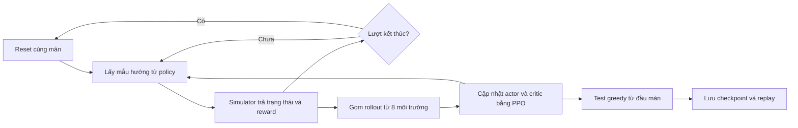

# Thiết kế PPO tự chơi HungryWorm theo từng màn

## Mục tiêu

Huấn luyện một checkpoint cho một màn đã xác minh, theo cách repo Mario tổ chức world và stage. Mỗi lần chạy chọn một cặp, ví dụ `A/6`. Tám môi trường giữ tám trạng thái chơi độc lập trên cùng bản đồ. Policy học qua lượt tự chơi. Checkpoint đạt khi tự vào cổng ở bài test greedy. Kết quả chuyên từng màn đo khả năng học đúng màn đó. [Đối chiếu repo Mario](MARIO_PPO_REFERENCE.md)

WormLabRL đã có simulator, vòng PPO theo màn, script tải checkpoint và replay. Cần chốt hợp đồng môi trường, reward, giao thức đánh giá và quy tắc tăng ngân sách. [Script train và test](train_worm_stage.py)

## Môi trường, state và action

| Thành phần | Thiết kế |
| --- | --- |
| Reset | Mỗi môi trường trở về đầu màn. Checkpoint được khóa theo mã màn và hash của tập map. |
| State | Bản đồ tĩnh, thân sâu theo thứ tự từ đầu đến đuôi, táo và đá còn lại, bộ đếm bước và tập trạng thái đã ghé trong lượt. |
| Quan sát | MLP nhận 23 đặc trưng cho mỗi hướng, gồm tương quan với cổng, thay đổi độ cao và kết quả mô phỏng một bước. Tùy chọn CNN đọc thêm tensor lưới hiện tại. |
| Action | Trái, phải, lên, xuống. Mỗi lệnh gọi đúng một bước simulator với va chạm, đẩy đá, ăn táo và trọng lực. |
| Action mask | Cố định trong mỗi phép so sánh. Mặc định `safe` giữ các hướng an toàn nếu còn hướng như vậy. Chế độ `legal` lọc hướng bị chặn nếu còn hướng hợp lệ. |
| Kết thúc lượt | Vào cổng, chết, chọn hướng bị chặn, lặp đúng trạng thái hoặc hết giới hạn mặc định 250 lệnh. Môi trường vừa kết thúc tự reset. |

Lời giải có sẵn dùng để xác minh luật và thứ tự thân sâu ban đầu khi cần. Rollout theo màn bắt đầu ở đầu map và nhận chuyển trạng thái, reward từ simulator. PPO cập nhật từ hành động do chính policy lấy mẫu. Bản hiện tại dùng kết quả mô phỏng một bước và cộng 8 vào logit nếu hướng đó vào cổng ngay. Test dùng cùng mask và quy tắc chấm điểm như train. [Luật simulator](worm_physics.py#L80) · [Đặc trưng](train_worm.py#L47) · [Action mask](train_worm_ppo.py#L25)

## Reward và vòng sửa sai

| Sự kiện | Reward PPO hiện tại |
| --- | ---: |
| Vào cổng | +4 |
| Chạm bẫy, rơi, bị nghiền hoặc chọn hướng bị chặn | −2 |
| Bước thường | −0,025, cộng tín hiệu tiến gần cổng tối đa ±0,25 |
| Ăn táo mới | Cộng 0,3 vào reward bước thường |
| Lặp trạng thái | Trừ 0,35 trong reward bước và trừ thêm 0,65 khi kết thúc |
| Hết số bước | Trừ thêm 0,5 ở bước cuối |

Actor lấy mẫu hành động từ phân phối categorical. Critic ước lượng phần thưởng còn lại. Sau mỗi rollout, PPO tính advantage từ chuỗi reward và dự đoán của critic. Hành động đem lại kết quả tốt hơn dự đoán có xu hướng được tăng xác suất. Hành động đem lại kết quả kém hơn có xu hướng bị giảm xác suất. Clipping giới hạn cập nhật. Vì advantage lấy tín hiệu từ chuỗi reward, nước đi trước khi lỗi xuất hiện cũng có thể bị điều chỉnh.

Nếu sâu lặp đúng trạng thái ở A6, lượt kết thúc là `loop` và môi trường trở về đầu A6. Trải nghiệm của lượt thua đi vào batch cùng các lượt khác. Policy sau cập nhật tiếp tục thử trên A6. [Vòng PPO](train_worm_ppo.py#L97)



## Cấu hình và tiêu chí bắt đầu

1. **Một job, một map.** Dùng 8 môi trường theo batch, horizon 64, 4 epoch PPO, minibatch 256, learning rate `2.5e-4`, seed 73 và 98.304 bước môi trường. Số bước tính trên tổng 8 môi trường. Mỗi rollout đủ horizon gom 512 quyết định.
2. **Chọn khởi tạo.** Dùng `--init ppo` để lặp lại thiết lập đã thắng A4 và A6. Để đo học từ đầu theo cách repo Mario, chạy riêng `--init scratch` trên một màn dễ. Cả hai dùng PPO từ lượt tự chơi trong đợt theo map. Dùng MLP cho phép đo đầu để dễ đối chiếu.
3. **Test và chốt checkpoint.** Tải checkpoint đúng màn, reset rồi chạy greedy trong giới hạn bước. Một lượt đạt khi simulator xác nhận vào cổng. Ghi số bước tới lượt thắng đầu tiên, số lệnh của đường thắng và tần suất rơi, lặp hay hết bước. Dùng các seed huấn luyện độc lập để đo độ ổn định.
4. **Tăng ngân sách theo dữ liệu.** Nếu lượt tự chơi đã tìm ra nhiều đường thắng nhưng greedy chưa thắng, kiểm tra checkpoint theo mốc. Nếu hầu như không có lượt thắng, thử đối chứng reward trước khi kéo dài ngân sách. Giữ thưởng vào cổng, phạt chết, chi phí bước và phạt lặp. Tạm tắt điểm tiệm cận cổng và ăn táo ở nhánh đối chứng để đo tác động của hai tín hiệu ấy. Đối chứng này là thiết kế thí nghiệm, cần thêm cờ reward trước khi chạy.
5. **Replay.** `episodes.jsonl` ghi các lượt kết thúc. `replay.html` hiện hiển thị một số lượt tự chơi đã chọn và lượt greedy của checkpoint tốt nhất. Muốn xem đầy đủ quá trình, bổ sung ID môi trường, ID episode, số bước toàn cục và phiên bản policy vào log. Ghi cả reward thực sự đưa vào PPO, vì tổng reward hiện có chưa gồm khoản trừ thêm lúc lặp hoặc hết bước.

## Kết quả hiện có và lệnh chạy

| Màn | PPO dùng chung trước khi train riêng | Greedy tốt nhất sau train riêng |
| --- | --- | --- |
| A4 | Rơi | Thắng trong 22 lệnh |
| A6 | Lặp | Thắng trong 20 lệnh |
| A67 | Rơi | Lặp, kể cả lượt mở rộng 196.608 bước |

CNN khởi tạo mới có 21 lượt thắng khi lấy mẫu ở A4 sau 32.768 bước, nhưng greedy vẫn lặp. Lượt thắng lấy mẫu cho thấy agent đã thử được đường thắng. Bài kiểm tra greedy cho biết checkpoint có chủ động chọn được đường thắng hay không. [A4](worm_stage_runs/A4_mlp_ppo_2.5e-4/metrics.json) · [A6](worm_stage_runs/A6_mlp_ppo_2.5e-4/metrics.json) · [A67](worm_stage_runs/A67_extended/metrics.json) · [A4 CNN](worm_stage_runs/A4_cnn_scratch_2.5e-4/metrics.json)

Chạy mỗi lệnh dưới đây từ thư mục WormLabRL. Ví dụ dùng màn A6 và một thư mục đầu ra mới.

```powershell
python train_worm_stage.py train --world A --stage 6 --envs 8 --horizon 64 --steps 98304 --lr 2.5e-4 --init ppo --eval-every 24 --out worm_stage_runs/A6_new
python train_worm_stage.py test --world A --stage 6 --checkpoint worm_stage_runs/A6_new/best.pt
```

Đổi `--world` và `--stage` để chọn màn khác. `--steps` phải chia hết cho `--envs`. Có thể chỉnh `--max-episode-steps` để đổi giới hạn một lượt. Giữ giới hạn cố định khi so hai checkpoint.