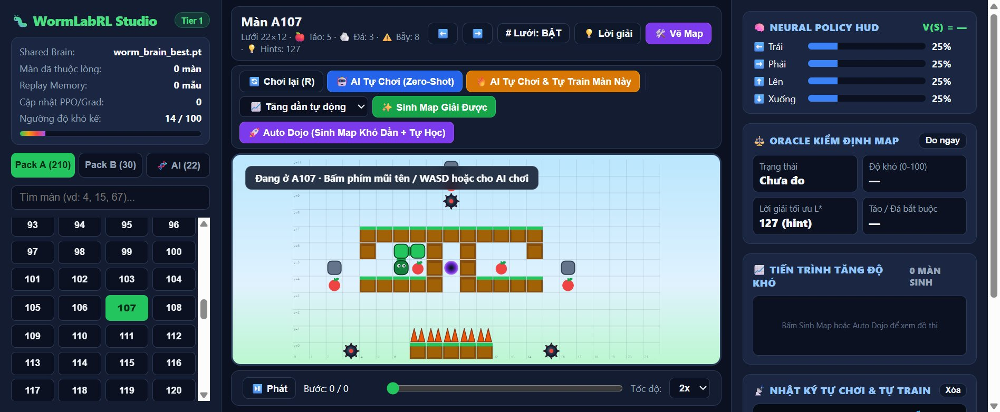
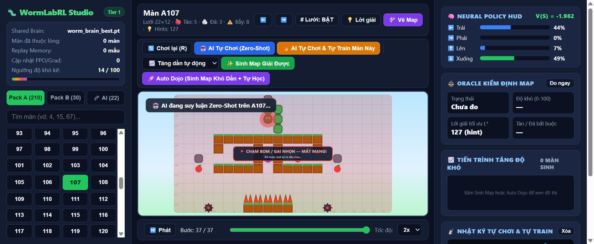
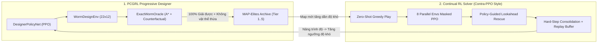

# 🐛 WormLabRL — Continual Self-Play RL Solver, Progressive PCGRL Map Designer & Interactive AI Studio


**WormLabRL** là hệ sinh thái Học Tăng Cường (Reinforcement Learning) và Sinh Nội Dung Tự Động (PCGRL) khép kín cho tựa game giải đố vật lý **Hungry Worm (Apple Worm)**, lấy cảm hứng từ phong cách huấn luyện tự chơi song song của [`Contra-PPO-pytorch`](https://github.com/vietnh1009/Contra-PPO-pytorch) (Việt Nguyễn AI) và mở rộng chuyên sâu cho bài toán giải đố không gian nhiều bước ngay trên **CPU**.

Hệ thống hội tụ **4 năng lực cốt lõi**:
1. **Tự chơi & Tự train liên tục sau mỗi màn (`Continual Self-Play PPO`)**: Khi gặp màn mới, Agent thử sức *Zero-Shot* bằng mạng chung `WormBrainNet`, sau đó tự chạy các vòng **Masked PPO** song song kết hợp tìm kiếm nhìn trước có định hướng và **Continual Replay Buffer** để chinh phục màn mới mà **không quên các màn cũ**.
2. **Vật lý tất định nghiêm ngặt (`Strict Deterministic Physics`)**: Trọng lực kéo rơi từng ô khi không có vật đỡ rắn; Bom gai (`id=7`) và Gai nhọn (`id=3,9,10,11`) gây mất mạng ngay lập tức khi rơi/chạm vào; tự động phát hiện thế kẹt hết nước đi sống sót (`deadlock`) và bắt buộc reset về đầu màn.
3. **Tự sinh Map mới 100% giải được & Độ khó tăng dần (`Progressive PCGRL + Exact Oracle`)**: Mạng `DesignerPolicyNet` kết hợp bộ kiểm chứng chính xác A\* và kiểm định phản thực tế (*Counterfactual Audit*), đảm bảo mọi quả táo/viên đá trên bản đồ sinh ra đều **thực sự bắt buộc phải dùng**, tự nâng bậc từ `Tier 1 (Easy)` lên `Tier 5 (Grandmaster)`.
4. **Interactive Web Studio trực quan thời gian thực**: Vừa tự tay chơi thử bằng bàn phím, vừa xem AI suy luận xác suất 4 hướng `⬅️ ➡️ ⬆️ ⬇️` + giá trị $V(s)$, vừa bấm tự train trực tiếp, tự vẽ map mới kiểm chứng bằng Oracle hoặc bật **Auto Co-Evolution Dojo**.

---

## 📸 Giao diện Trực quan (WormLabRL Studio)

| Màn chơi & Neural Policy HUD trực tiếp | Hiệu ứng chạm Bom/Gai nổ mất mạng & Reset về đầu màn |
| :---: | :---: |
|  |  |

---

## 🏗️ Kiến trúc Hệ thống



### 1. Lõi Vật lý Nghiêm ngặt (`worm_physics.py`, `worm_ai/physics.py`)
- **Kích thước lưới chuẩn**: `22 × 12` (`240` màn chơi gốc trong `hungry_worm_levels.json` + kho màn PCGRL sinh tự động).
- **Quy tắc đỡ & rơi trọng lực (`hazard_support = False`)**:
  - Chỉ các vật thể rắn gồm `Tường/Đất (id=1)`, `Đá (id=2)`, `Táo (id=4)` và `Cổng (id=8)` mới đỡ được thân sâu.
  - **Bom gai (`id=7`)** và **Gai nhọn (`id=3,9,10,11`)** tuyệt đối không đỡ sâu: hễ toàn thân sâu không có điểm tựa rắn bên dưới là trọng lực kéo rơi xuống từng ô (`step_trace`), chạm bom/gai là mất mạng ngay lập tức (`trap`), rơi quá đáy bản đồ (`y < 0`) là mất mạng (`fall`).
- **Phát hiện Thế kẹt (`deadlock`) tức thì**: Ngay sau khi một nước đi dừng rơi mà trạng thái mới không còn bất kỳ nước đi sống sót nào (`0` hướng cho kết quả `ok` hoặc `win`), ván chơi kết thúc ngay với `deadlock` và buộc chơi lại từ đầu màn.

### 2. Mạng `WormBrainNet` & Tự Huấn Luyện Liên Tục (`worm_ai/model.py`, `worm_ai/trainer.py`)
- **Kiến trúc Dual-Stream siêu nhẹ cho CPU (`77,380` tham số)**:
  - **Nhánh Không gian Toàn cục**: Tensor `12 × 12 × 22` đi qua `3` khối **Multi-Scale Dilated ResNet** (`dilation = 1, 2, 4`) + *Squeeze-and-Excitation* bao phủ toàn bộ bản đồ `22 × 12`, trích xuất đặc trưng tại đúng ô đầu sâu, ô cổng đích và Global Avg/Max Pooling.
  - **Nhánh Mô phỏng Nhìn trước 1 Bước**: Tensor `4 × 26` mô tả kết quả chuyển trạng thái thật của từng hướng (`Trái, Phải, Lên, Xuống`), độ dốc khoảng cách BFS tới cổng/táo, số đốt có điểm tựa và bậc tự do sau nước đi.
  - **Lossless Safe-Legal Action Masking**: Tự động che các hướng đâm tường/thân/đá kẹt hoặc tự sát tức thì khi vẫn còn hướng sống sót — tăng tốc hội tụ gấp nhiều lần mà không bỏ sót bất kỳ đường thắng hợp lệ nào.
- **Chu trình Tự học Sau Mỗi Màn (`play_and_self_train_stage`)**:
  1. Chơi thử *Zero-Shot Greedy* với bộ trọng số hiện tại.
  2. Khởi chạy `8` môi trường song song thu thập quỹ đạo và cập nhật bằng **Clipped Masked PPO + GAE** ($\gamma=0.99, \lambda=0.95$).
  3. Với các màn giải đố đánh lừa tư duy có độ sâu lớn, kích hoạt **Policy-Guided Lookahead Rescue** để tự khám phá đường thoát hiểm (không cần lời giải bên ngoài) và chưng cất có trọng số (*Hard-Step Margin Consolidation*) trộn 50/50 cùng `ContinualReplayBuffer` chống quên màn cũ.

### 3. Bộ Kiểm chứng `ExactWormOracle` & Sinh Map `PCGRL` (`worm_ai/oracle.py`, `worm_ai/pcgrl.py`)
- **Admissible Gravity A\***: Sử dụng hàm heuristic không đánh giá quá mức dưới trọng lực $h(x, y) = \min_{(g_x, g_y)} \big(|x - g_x| + \max(0, g_y - y)\big)$ để chứng minh chính xác 100% tính giải được và tìm độ dài lời giải tối ưu $L^*$.
- **Kiểm định Phản thực tế (*Counterfactual Mandatory Mechanics*)**: Thử gỡ bỏ từng quả táo / đóng băng từng viên đá và giải lại để xác nhận vật thể đó **thực sự bắt buộc phải tương tác** mới qua được màn; tự động dọn sạch mọi quả táo thừa trước khi xuất bản đồ.
- **Thang Độ khó Tự động Leo thang (`0–100` điểm)**: Phân tầng `Tier 1 (Easy)` $\to$ `Tier 2 (Medium)` $\to$ `Tier 3 (Hard)` $\to$ `Tier 4 (Extreme)` $\to$ `Tier 5 (Grandmaster)`.

---

## 📂 Cấu trúc Thư mục

```text
WormLabRL/
├── worm_ai/                         # Package AI cốt lõi
│   ├── __init__.py
│   ├── physics.py                   # Luật vật lý nghiêm ngặt, trường khoảng cách BFS, mã hóa Tensor kép
│   ├── oracle.py                    # Bộ giải chính xác A*, kiểm định táo/đá bắt buộc & chấm điểm độ khó
│   ├── model.py                     # Kiến trúc mạng WormBrainNet (Dilated ResNet + Action Head)
│   ├── trainer.py                   # Vòng lặp Contra-PPO song song, Lookahead Rescue & Replay chống quên
│   └── pcgrl.py                     # Môi trường WormDesignEnv, DesignerPolicyNet & MAP-Elites Archive
│
├── studio/
│   └── index.html                   # Giao diện Web Studio (Playable + Live AI HUD + Dojo + Map Editor)
├── studio_server.py                 # Máy chủ FastAPI cung cấp REST & Streaming NDJSON thời gian thực
│
├── train_product.py                 # CLI huấn luyện kiểu Contra-PPO (foundation / stage / campaign)
├── test_product.py                  # CLI đánh giá Zero-Shot & tự thích nghi online trên map mới
├── generate_map.py                  # CLI sinh gói map mới 100% giải được & độ khó tăng dần
├── evolve_curriculum.py             # CLI vòng lặp đồng tiến hóa tự động giữa PCGRL Designer và RL Solver
│
├── checkpoints/                     # Trọng số đã huấn luyện sẵn (chạy được ngay khi clone)
│   ├── worm_brain_best.pt           # Checkpoint mạng giải đố WormBrainNet
│   └── pcgrl_designer.pt            # Checkpoint mạng thiết kế màn chơi DesignerPolicyNet
├── generated_maps/                  # Kho map mới do AI sinh & đã đóng dấu kiểm chứng Oracle
│   ├── archive.json                 # Kho lưu trữ đa dạng MAP-Elites (44+ màn độc bản)
│   └── escalating_pack.json         # Gói 5 màn mẫu tăng dần độ khó từ Easy -> Grandmaster
│
├── tests_worm/
│   └── test_ecosystem.py            # Bộ kiểm thử tự động vật lý, bom/gai, deadlock, Oracle & chống quên
├── hungry_worm_levels.json          # Bộ dữ liệu 240 màn chơi gốc (Pack A: 210 màn, Pack B: 30 màn)
├── hungry_worm_elements.json        # Định nghĩa 11 mã thực thể gốc của game
├── worm_physics.py                  # Mô-đun mô phỏng chuyển động cơ sở & kiểm chứng quỹ đạo
├── requirements.txt                 # Danh sách thư viện Python
└── pyproject.toml                   # Cấu hình đóng gói & CLI scripts
```

---

## 🚀 Cài đặt & Khởi chạy Nhanh

### 1. Cài đặt môi trường
Yêu cầu **Python 3.10+** (tối ưu chạy mượt ngay trên **CPU** phổ thông, tự động tận dụng GPU nếu có):

```bash
git clone https://github.com/namhv521/WormLabRL.git
cd WormLabRL
pip install -r requirements.txt
```

### 2. Mở Giao diện Sản phẩm Web Studio (Khuyên dùng)
```bash
python studio_server.py --port 8018
```
Mở trình duyệt tại **`http://127.0.0.1:8018`**:
- **Tự chơi thử**: Dùng phím `Mũi tên` hoặc `WASD` để điều khiển sâu (`R` để chơi lại, `Z` để hoàn tác khi còn sống). Nếu rơi chạm bom/gai hoặc vào thế kẹt, game sẽ nổ hiệu ứng mất mạng và tự động reset về đầu màn.
- **🤖 AI Tự Chơi (Zero-Shot)**: Xem `WormBrainNet` tự giải màn hiện tại kèm thanh xác suất 4 hướng theo thời gian thực.
- **🔥 AI Tự Chơi & Tự Train Màn Này**: Xem AI chạy các vòng PPO tự học lại ngay sau màn chơi và đối chiếu quỹ đạo *Trước khi train* vs *Sau khi train*.
- **✨ Sinh Map Giải Được / 🚀 Auto Dojo**: Bấm sinh map mới có độ khó tăng dần hoặc bật vòng lặp tự động sinh map khó hơn $\to$ AI tự chinh phục liên tục.
- **🛠️ Vẽ Map**: Tự tay thiết kế map trên lưới `22 × 12`, bấm **Oracle Kiểm Chứng** và thách đấu AI giải map bạn vừa vẽ.

---

## 💻 Hướng dẫn Sử dụng CLI (Phong cách Contra-PPO)

### 1. Tự chơi & tự train trên 1 màn cụ thể (`--mode stage`)
```bash
python train_product.py --mode stage --world A --stage 107 --envs 8 --ppo-rounds 4
```
*(Tự động lưu trọng số mới và xuất file xem lại offline tại `checkpoints/replay_A107.html`).*

### 2. Chạy chiến dịch tự học liên tục qua từng màn (`--mode campaign`)
```bash
python train_product.py --mode campaign --limit-stages 25
```

### 3. Huấn luyện lại từ đầu toàn bộ Foundation Brain & PCGRL Designer
```bash
python train_product.py --mode foundation --warm-epochs 10 --threads 6 --out checkpoints
```

### 4. Sinh gói Map mới 100% giải được với độ khó tăng dần nghiêm ngặt
```bash
python generate_map.py --escalating --count 5 --out generated_maps/escalating_pack.json
```

### 5. Kiểm thử khả năng tự giải & tự thích nghi khi gặp Map mới
```bash
# Đánh giá trên tập màn mới do PCGRL sinh ra:
python test_product.py --map-file generated_maps/escalating_pack.json --adapt

# Đánh giá trên tập Test giữ riêng từ bộ màn gốc:
python test_product.py --split test --adapt
```

### 6. Chạy vòng lặp Đồng tiến hóa Tự động (Co-Evolution Dojo)
```bash
python evolve_curriculum.py --rounds 8 --out generated_maps/coevolution_run
```

### 7. Chạy bộ kiểm thử tự động (Unit & Regression Tests)
```bash
python tests_worm/test_ecosystem.py
```

---

## 📊 Kết quả Thực nghiệm Mẫu (Chuẩn Vật lý Nghiêm ngặt trên CPU)

Kết quả sinh tự động 5 màn tăng dần độ khó (`generated_maps/escalating_pack.json`) và cho `WormBrainNet` tự thích nghi trực tuyến trên CPU:

| Thứ tự | Mã Map | Phân bậc | Điểm Độ Khó (`0-100`) | Lời giải tối ưu $L^*$ | Cơ chế bắt buộc | Zero-Shot | Sau Tự Train Online |
| :-: | :--- | :--- | :-: | :-: | :---: | :-: | :-: |
| 1 | `G1001_T1` | Tier 1 — Easy | **17.6** | 11 bước | 1 Táo | **WIN (11b)** | **WIN (11b)** |
| 2 | `G1002_T2` | Tier 2 — Medium | **54.3** | 16 bước | 2 Đá đẩy + Bẫy tư duy | `deadlock` | **WIN (16b)** |
| 3 | `G1003_T3` | Tier 3 — Hard | **63.4** | 27 bước | 2 Táo + 1 Đá đẩy | `loop` | **WIN (27b)** |
| 4 | `G1004_T4` | Tier 3 — Hard | **64.3** | 26 bước | 2 Táo + Bẫy tư duy | `deadlock` | **WIN (26b)** |
| 5 | `G1005_T5` | Tier 5 — Grandmaster | **80.6** | 48 bước | 2 Táo + 1 Đá đẩy | `loop` | **WIN (48b)** |

---

## 📄 Giấy phép (License)

Dự án được phân phối dưới giấy phép [MIT License](LICENSE).
