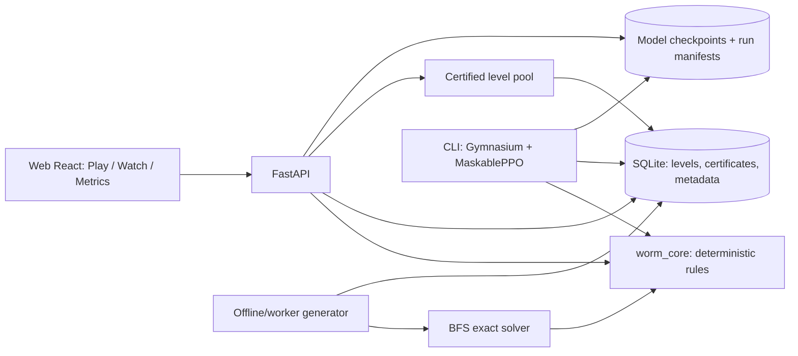

# SPEC-04 — System architecture & repository layout

## 1. Kiến trúc đề xuất

**Modular monorepo**, source-of-truth rules trong Python core. Website dùng API để khởi tạo session và gửi action; không duy trì bản game engine tách biệt có khả năng lệch luật.



## 2. Components & responsibilities

| Component | Trách nhiệm | Không làm |
|---|---|---|
| `worm_core` | Validate level, reset, transition, mask, terminal, replay | Train, sinh map, render web |
| `solver` | BFS theo ruleset, certify path, count expansions | Không quyết định policy RL |
| `generator` | Candidate constraints, retry, grade, dedup, pool | Không publish nếu thiếu replay proof |
| `rl_env` | Adapter Gymnasium, observation/reward, level sampler | Không định nghĩa luật game khác core |
| `ml` | Train/eval, callbacks, registry, baselines | Không gọi BFS trong model inference |
| `api` | Schemas, session, generate, solve, metrics | Không train GPU synchronous trong API |
| `web` | Gameplay UI, AI replay, charts, error states | Không tự quyết định hợp lệ của move |
| `storage` | Map/certificate/checkpoint metadata, transaction | Không giữ khóa lưu trữ trong browser |

## 3. Cấu trúc repository *dự kiến sau khi implement*

```text
wormlab-rl/
├── README.md
├── PRD.md
├── PLAN.md
├── spec/                    # bộ tài liệu hiện tại
├── apps/
│   └── web/                 # React + TypeScript + Vite
├── services/
│   └── api/                 # FastAPI routers, sessions, auth later
├── packages/
│   ├── worm_core/           # rules + pure state transition
│   ├── solver/              # BFS + solution verification
│   ├── generator/           # candidates, difficulty, dedup, pool
│   └── rl_env/              # Gymnasium wrapper
├── ml/
│   ├── train.py
│   ├── evaluate.py
│   └── baselines.py
├── configs/
│   ├── rulesets/
│   └── train/
├── data/
│   ├── levels/              # tracked fixtures, not huge training dumps
│   └── manifests/           # train/val/test snapshot hashes
├── artifacts/               # ignored large checkpoints/logs
├── tests/
│   ├── unit/
│   ├── property/
│   ├── integration/
│   └── e2e/
└── docker-compose.yml
```

Tài liệu này **chưa chứa code runtime**; cấu trúc trên là target skeleton cho milestone tiếp theo.

## 4. Data flow chi tiết

### 4.1. Sinh level

1. `generator.worker` nhận tier/seed/config.
2. Candidate được `worm_core.validate_level`.
3. `solver.solve` trả result; `worm_core.replay` xác minh.
4. `difficulty.score` chọn tier; dedup dùng canonical hash.
5. Trong DB transaction, ghi `levels`, `certificates`, `pool_entries` cùng status `PUBLISHED`.
6. API chỉ chọn `PUBLISHED` và `verified_by_replay=true`.

### 4.2. Gameplay

1. `POST /sessions` tạo snapshot state từ `level_id`.
2. User action từ React → `POST /sessions/{id}/actions`.
3. API gọi `worm_core.step` và lưu state session.
4. API gửi lại snapshot + flags; React render lại, không tự tính collision.
5. Khi `WON` hoặc `LOST` hoặc `TIMEOUT`, disable action và cho phép restart.

### 4.3. AI replay

1. API load level + model version.
2. Với `RL`, chạy policy tuần tự trên observation+mask đến terminal/timeout/deadlock; lưu path và metrics.
3. Với `BFS`, trả certified path từ certificate, replay validate phiên bản.
4. Web hiện rõ nhãn **RL attempt** hoặc **BFS verified solution**, kết quả có thể khác nhau.

### 4.4. Training

1. CLI load versioned train pool và config, xác thực không lẫn validation/test canonical hash.
2. Spawn env workers, train maskable policy, log checkpoints.
3. Callback chạy validation không sửa test; checkpoint được lưu kèm manifest.
4. Sau training, test evaluation độc lập ghi summary; API chỉ expose metadata từ completed runs.

## 5. Storage & consistency

### 5.1. MVP persistence

- **SQLite**: `levels`, `certificates`, `pool_entries`, `model_registry`, `training_runs`, `benchmark_results`; bật WAL trong demo single-machine.
- **Local filesystem**: serialized model zip + immutable model manifest + logs; file path nội bộ **không** lộ trong public API.
- **In-memory**: game sessions có TTL 30 phút từ hoạt động cuối; restart server có thể mất session, UI thông báo.
- Dữ liệu test benchmark đóng băng theo manifest, lưu checksum SHA-256 ở level và dataset.

### 5.2. Transaction policy

Không phát hành map khi chỉ mới có entry trong bảng level mà thiếu certificate. Sử dụng transaction và trạng thái `CANDIDATE` → `PUBLISHED` sau verify, index unique `(ruleset_id, canonical_hash)` để tránh race.

## 6. Config & versioning

- `ruleset_id` và `ruleset_version`: không thay đổi semantics sau khi công bố.
- `schema_version`: map JSON contract.
- `generator_version`: thuật toán và phân bố candidate.
- `solver_version` & `difficulty_version`: thay khi tie-break/count/score đổi.
- `model_id`: checkpoint immutable + `observation_shape=(6,8,8)` + action mapping + ruleset.
- Dùng `.env.example` cho đường dẫn, port, size budgets, mode development; không commit secrets.

## 7. Performance & deployment

- Demo localhost chạy API + web; generator chạy worker CLI riêng để prefill pool; model inference CPU đủ cho small board (cần đo benchmark).
- Mục tiêu API move p95 ≤150ms trên profile tham chiếu; logging hiển thị `elapsed_ms` theo phase.
- Request solve RL có max inference time 2s hoặc max_steps, trả timeout rõ; BFS có thể lấy certificate đã persist.
- Limit request body, `level_id`, `seed` và `count`; cấm upload path/code từ người dùng trong MVP.
- Nếu public: thêm auth cho admin routes, request rate limiting, CORS allowlist, HTTPS và session store phù hợp multi-instance.

## 8. Observability

Structured logs có `request_id`, `level_id`, `run_id` hoặc `model_id`, `ruleset`, `duration_ms`, `outcome`, `error_code`.

Metrics chính: `api_move_latency_ms`, `generation_reject_reason_total`, `bfs_expanded_nodes`, `pool_size_by_tier`, `rl_success_rate_by_tier`, `solver_limit_rate`, `replay_verification_failures`.

## 9. Kiểm soát rủi ro kiến trúc

- **Một engine duy nhất:** e2e test so web API action outcomes với direct core.
- **BFS timeout không phải vô nghiệm:** `LIMIT` được lưu reject reason riêng.
- **Cạn pool:** client nhận 503 và thông báo minh bạch.
- **Model không tương thích:** API trả `MODEL_INCOMPATIBLE` thay vì đoán action mapping.
- **Thay rule:** tăng ruleset version và regenerate certificates/test sets, không âm thầm dùng dataset cũ.
