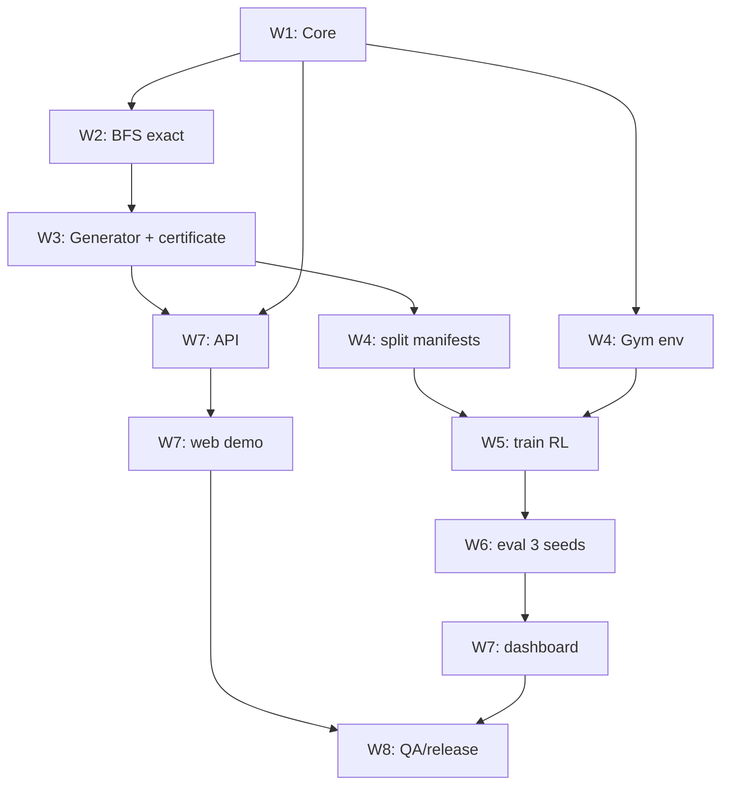

# Implementation plan — WormLab RL MVP (8 tuần)

**Bắt đầu dự kiến:** `[Ngày start — TBD]`  
**Owner:** `[Tech lead — TBD]`  
**Quan hệ ưu tiên:** correctness + certified level generation → RL experiment → playable demo → quality/report.

## 1. Milestones & deliverables

| Week | Mục tiêu | Task có thể giao | Deliverable / exit gate |
|---|---|---|---|
| W1 | Core rules | `CORE-01` level schema; `CORE-02` state transition; `CORE-03` mask; `CORE-04` fixtures/property tests | G1 engine fixture pass |
| W2 | Exact solver | `SOL-01` BFS; `SOL-02` path replay; `SOL-03` LIMIT semantics; `SOL-04` independent optimality tests | 100 fixture optimal verified |
| W3 | Generator | `GEN-01` candidate; `GEN-02` certify; `GEN-03` difficulty; `GEN-04` dedup/pool | 30 map/band certified hoặc báo band không đủ |
| W4 | RL env/data | `RL-01` Gym adapter; `RL-02` observation/mask; `RL-03` split generator; `RL-04` baselines | Train/val/test manifest khóa, smoke eval |
| W5 | RL training | `RL-05` MaskablePPO; `RL-06` checkpoint; `RL-07` callbacks/run manifest | Ít nhất 1 train run load & evaluate được |
| W6 | RL research | `RL-08` curriculum; `RL-09` 3 seed runs; `RL-10` ablations nếu còn thời gian | Report performance thật theo tier, không leakage |
| W7 | Demo | `API-01` levels/sessions; `API-02` solve/agents; `WEB-01` play; `WEB-02` replay; `WEB-03` experiments | Generate → play → AI replay → metrics |
| W8 | QA & release | `QA-01` e2e; `QA-02` perf; `QA-03` versioning/readme; `REL-01` release report | G1–G3 pass, G4 measured/reported |

## 2. Task graph (đường găng)

## 3. Development tickets — definition of done

### P0 — Engine & solver

- [ ] `CORE-01`: Strict schema validation, deterministic serialization and sample fixture tests.
- [ ] `CORE-02`: `step(state, action)` pure engine + terminal `WON/LOST/TIMEOUT`.
- [ ] `CORE-03`: Derive action mask from the same move legality function.
- [ ] `SOL-01`: BFS queue, visited hash, optimal path; explicit `SOLVED/EXHAUSTED/LIMIT`.
- [ ] `SOL-02`: Verification replays certificate via core, checks step budget, rejects failures.
- [ ] `SOL-03`: Independent small board fixture reference ensures BFS optimality.

### P0 — Procedural generation

- [ ] `GEN-01`: Candidate construction with versioned seed/config.
- [ ] `GEN-02`: Reject unsolved/unknown/nonreplayable levels.
- [ ] `GEN-03`: Stable difficulty score + tier mapping, reject wrong tier.
- [ ] `GEN-04`: Canonical orientation hash/dedup; persistent pool and emptiness error.
- [ ] `GEN-05`: Prefill 30 verified levels for each released band.

### P0 — Reinforcement learning

- [ ] `RL-01`: Gymnasium `(6,8,8)` observation, Discrete(4), masks, reward, reset/step.
- [ ] `RL-02`: Train/val/test canonical split, immutable test manifest.
- [ ] `RL-03`: Random/Greedy/BFS baselines.
- [ ] `RL-04`: MaskablePPO train smoke test, load/save and model metadata checks.
- [ ] `RL-05`: Curriculum training + 3 independent seeds within compute budget.
- [ ] `RL-06`: Model-only inference, success stats + actual benchmark report.

### P0 — API, web & evaluation

- [ ] `API-01`: `/levels/generate`, `/levels/{id}`, strict published only.
- [ ] `API-02`: Session create/action/restart routes, error/TTL handling.
- [ ] `API-03`: `/solve`, `/agents`, `/training-runs`, model compatibility.
- [ ] `WEB-01`: Play board/keyboard/touch and clear terminal/loading/error states.
- [ ] `WEB-02`: AI replay with RL vs BFS labels and independent outcomes.
- [ ] `WEB-03`: Experiment table/bar chart with counts, seeds and dataset IDs.
- [ ] `QA-01`: Traceability matrix and performance tests.

## 4. Dependencies & decisions

- **D-01:** Tất cả code dùng chung `worm-grid-v1` rules; thay semantics bắt buộc bump version.
- **D-02:** Không tối ưu RL bằng test set; test locked khi chia data.
- **D-03:** Không publish candidate có solver `LIMIT`, bất kể RL có thể may mắn giải được.
- **D-04:** Demo không cần account/auth nếu chỉ localhost, public deploy là phạm vi riêng.
- **D-05:** Chỉ số difficulty là algorithmic proxy, không đánh giá chủ quan con người.

## 5. Milestone exit gates

- **M1 — Rules stable:** pass `T-CORE-*`, game engine deterministic.
- **M2 — Certified generator:** pass `T-SOLVER-*`, `T-GEN-*`, đủ pool theo supported bands.
- **M3 — RL experiment reproducible:** có seed, manifest, baseline, checkpoint, holdout report.
- **M4 — Demo released:** `T-API-*`, `T-UX-*`, NFR và release report; công bố thật RL metric.

## 6. Nếu cần giảm phạm vi do thiếu thời gian

Giữ nguyên **engine → solver → generation certification → Gym + RL train/eval**. Có thể giảm dashboard chỉ còn bảng static hoặc hoãn animation; **không cắt** replay verification, train/test separation hoặc phân biệt RL/BFS. Đây là các yêu cầu làm nên giá trị nghiên cứu và tính đúng đắn của sản phẩm.

## 7. Roadmap sau MVP

- **V1.1 / P1:** Import/export map; human difficulty calibration; CNN RL extractor; imitation pretraining ablation.
- **V1.2 / P1:** Level editing UI, daily challenge, chia sẻ seed, mở rộng search/performance solver.
- **V2 / P2:** PCGRL generator; adversarial curriculum; ruleset có trọng lực/khối đẩy; versioned adapters cho game puzzle khác.
